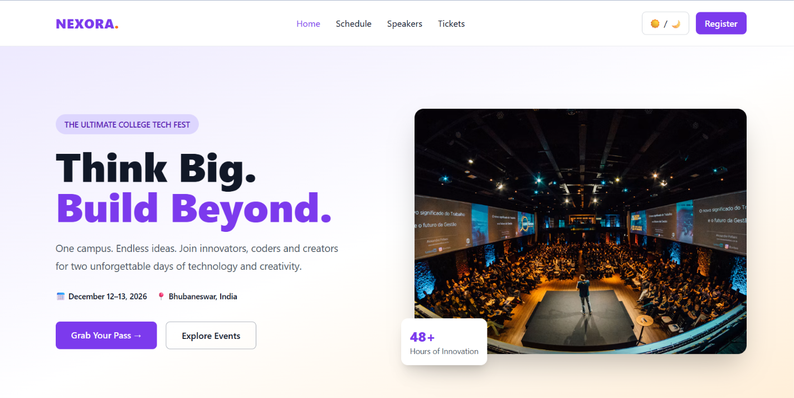
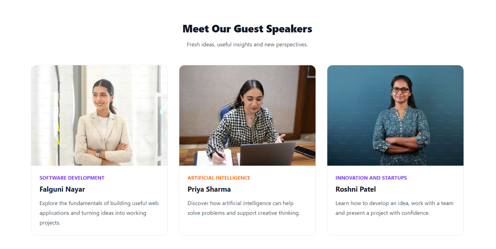
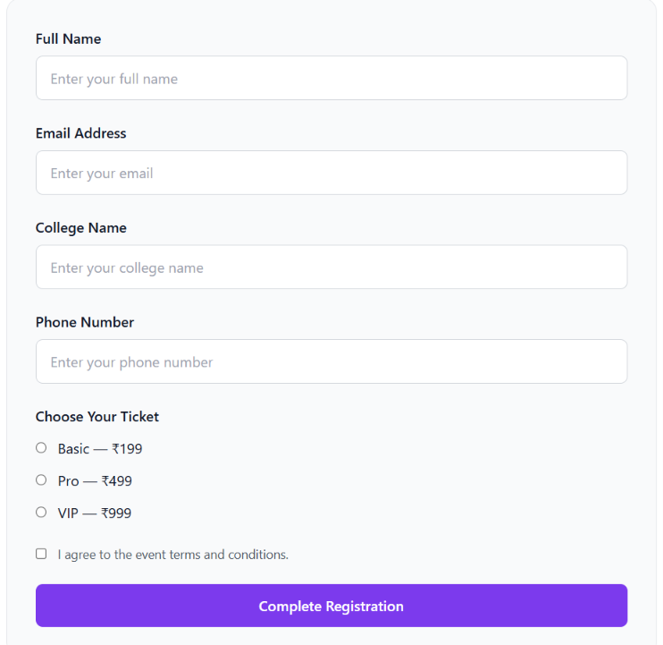
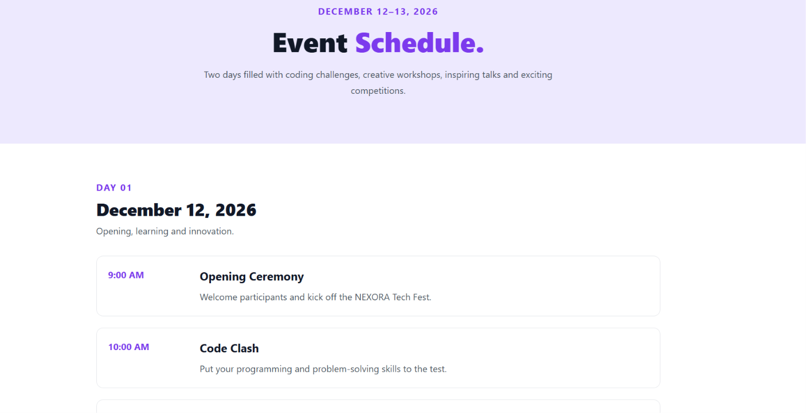
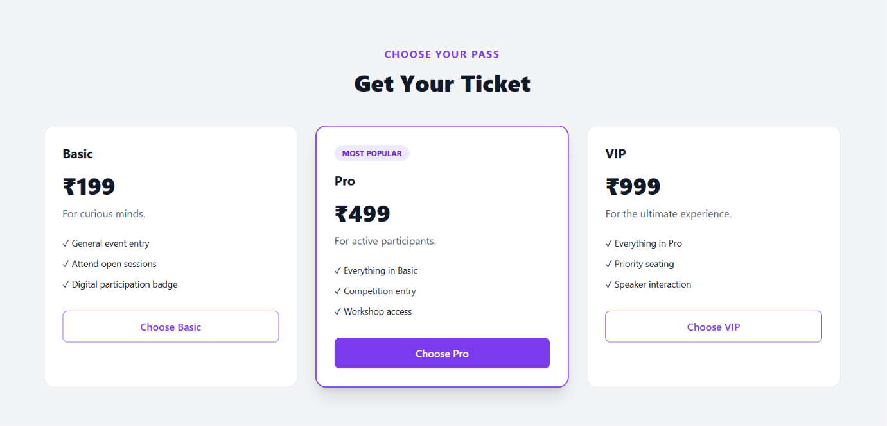
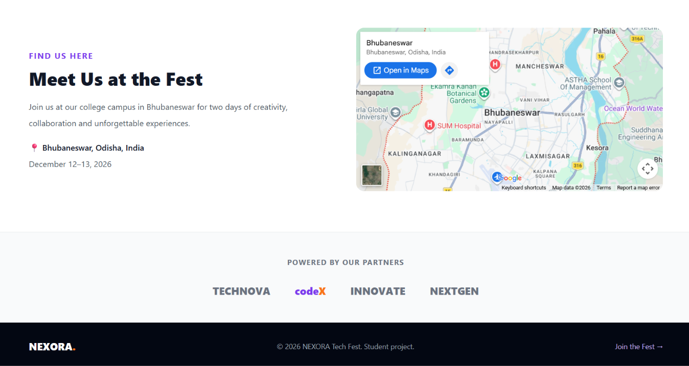

# College Tech Fest Microsite

## About the Project

This is a responsive college tech fest website designed to provide information about the event, speakers, schedule, ticket options, and registration process. It offers a simple and user-friendly experience across desktop, tablet, and mobile devices.

## Live Demo

[View the Live Website]()

## Features

- **Home Page:** Event introduction, date, venue, and registration button.
- **Register Page:** Registration form with radio buttons and a terms and conditions checkbox.
- **Speakers Page:** Displays featured speakers and their details.
- **Schedule Page:** Shows the event schedule and activities.
- **Ticket Pricing:** Displays ticket options using cards.
- **Venue Map:** Shows the event location using an embedded map.
- **Responsive Design:** Supports mobile, tablet, and desktop screens.
- **Dark Mode:** Allows users to switch the website theme.

## Technologies Used

- HTML5
- Tailwind CSS
- JavaScript

## Pages

1. Home
2. Register
3. Speakers
4. Schedule

## Screenshots

### Home Page


### Speakers Page


### Register Page


### Schedule Page


### Tickets


### Map / Location


## How to Run Locally

1. Clone the repository:

   ```bash
   git clone https://github.com/beherakiran/tech_fest_app.git
   ```

2. Open the project folder in VS Code.

3. Open `index.html` in your browser to view the website.

   Alternatively, use the **Live Server** extension in VS Code for a better development experience.

## GitHub Repository

[View Source Code on GitHub](https://github.com/beherakiran/tech_fest_app)
